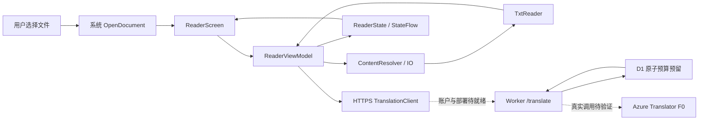

# Android 当前架构

核对日期：2026-11-13。职责：只描述当前代码的模块、依赖和数据流。产品应有行为见 [规格索引](docs/product-specs/index.md)，实现范围见 [当前状态](docs/product/current-state.md)。服务端代码存在不代表已部署。

## 模块与职责

项目只有一个 Android 模块 `:app`（[settings](settings.gradle.kts)）。包名及 applicationId 为 `com.bilingualauditor.app`；最低 SDK 26，编译/目标 SDK 35。Kotlin、Compose、Lifecycle/ViewModel 为实际依赖；版本及构建命令见 [开发说明](BilingualAuditor-docs/docs/development.md)，以 [模块配置](app/build.gradle.kts) 和 [根配置](build.gradle.kts) 核对。

| 当前对象 | 职责与依赖 |
| --- | --- |
| [MainActivity / ReaderScreen](app/src/main/java/com/bilingualauditor/app/MainActivity.kt) | Activity 启动 Compose 单阅读页；OpenDocument 选文件；收集状态、显示输入与替换提示，转交用户事件 |
| [ReaderViewModel / ReaderState](app/src/main/java/com/bilingualauditor/app/ReaderViewModel.kt) | StateFlow 保存原文、译文、导入/翻译状态及超限提示；请求代次隔离编辑、换文件和配置变更后的迟到结果；本人服务配置只在内存中 |
| [TxtReader / TxtImportException](app/src/main/java/com/bilingualauditor/app/TxtReader.kt) | 不依赖 Android UI 的流读取、字节上限、严格 UTF-8/BOM 解码及内容检查 |
| [TranslationPolicy](app/src/main/java/com/bilingualauditor/app/TranslationPolicy.kt) / [TranslationClient](app/src/main/java/com/bilingualauditor/app/TranslationClient.kt) | 独立的 10,000 码点业务限制、英文免请求策略；HttpsURLConnection 与 org.json 实现受控代理合同、安全错误映射、限时限长和禁止重定向 |
| [Worker](server/translation-worker/src/worker.mjs) / [英文保护](server/translation-worker/src/protection.mjs) | 鉴权、输入校验后代理 Azure；将英文片段置于 HTML 不翻译标记，严格还原并核验；不保存阅读内容 |
| [预算](server/translation-worker/src/budget.mjs) / [migration](server/translation-worker/migrations/0001_translation_budget.sql) | D1 单行条件 UPDATE 原子预留本人总预算和分钟请求数；数据库不可用时拒绝外发。历史 apply 与当前运行态分开核验，见 [Azure 计划](docs/plans/active/translation-integration.md) |
| [DeepSeek 独立试验](server/deepseek-translation-worker/README.md) | 当前本机 runner 进程内复用 handler、固定四样本和英文保护，使用 SQLite 持久预算与 `LOCAL_SQLITE_V1` 证明，不监听端口；本机四固定样本技术链路已通过，原预算账本四次认领已用完，工具退出；质量与人工验收另核。原 Worker/D1 保留但本轮不启用，不改 App 默认地址或自动后备 |
| [临时手机代理](server/deepseek-phone-proxy/README.md) / [PinnedTls](app/src/main/java/com/bilingualauditor/app/PinnedTls.kt) / [ProxyHealth](app/src/main/java/com/bilingualauditor/app/ProxyHealth.kt) | App → 电脑指定私有 IPv4 HTTPS → DeepSeek；精确手机来源、leaf DER pin、零模型 health；新本机 SQLite 独立预算，Windows 掩码进程窗口关闭即停。正式运行／真机状态见 [独立计划](docs/plans/active/deepseek-phone-hotspot-demo.md)，不复用旧四样本账本、不依赖云部署 |
| [Android 测试](app/src/test/java/com/bilingualauditor/app/) / [后端测试](server/translation-worker/test/) | 解析、长度及状态回归；后端假上游与本地 SQLite 并发测试；均不替代设备或真实服务验证 |
| [Manifest](app/src/main/AndroidManifest.xml) / [图标入口](app/src/main/res/mipmap-anydpi/ic_launcher.xml) | launcher Activity、主题与自适应图标；无已注册的分享接收入口 |
| [图标生成脚本](tools/generate-app-icon.ps1) | 从已确认原图生成位图与预览，输出至 res 与 output；不参与应用运行时翻译或读取 |

编辑事件也进入 ViewModel。确认替换发生在打开选择器之前，只有成功读出新文本才替换；取消选择没有导入调用。中文/混合文段在配置服务后可提交翻译；纯英文原样展示免请求。原文编辑后旧译文标记过期，失效请求不回写新内容。

## 数据和边界

原文、译文、本人 HTTPS 地址、访问凭证、模式与证书指纹仅在 ViewModel 内存中；配置变化可复用该实例，进程终止后不提供恢复保证。Compose 仅用 rememberSaveable 保存替换确认弹框状态，凭证不进入可保存状态。文件读取使用 `.use` 关闭流，未写回原文件。

代理合同为 `POST /translate`、Bearer 访问凭证、JSON `{text, requestId}`，成功返回 `{requestId, translation}`，失败返回安全的 `error.code/message`。手机长期代理的服务密钥与本人凭证分开，密钥留在服务端；已批准的本机 Azure 排查工具仅提供掩码内存输入例外，当前人工暂停。Azure 有历史 Worker/D1 部署记录，当前状态须按版本证据核验；DeepSeek 独立试验尚未部署/apply。配置与阶段分别见 [Azure 说明](server/translation-worker/README.md)、[DeepSeek 计划](docs/plans/active/deepseek-translation-trial.md) 和 [SECURITY](docs/SECURITY.md)。

编码、大小及错误边界见 [domain-boundaries](docs/architecture/domain-boundaries.md)；用户界面与导航见 [FRONTEND](docs/FRONTEND.md) 和 [IA](docs/architecture/ia-and-navigation.md)。

## 候选而非当前架构

未接入 Room、DataStore、TTS、词典 SDK 或 FSRS 调度。App 没有草稿/历史数据库；D1 schema 仅用于代理预算，不是阅读历史或云同步。后续产品合同见规格，技术候选与服务复核见 [技术评估](BilingualAuditor-docs/docs/technical-evaluation.md)。

`codex-teammode-workflow/` 是嵌套的上游工作流 checkout，不是 Android 模块；docs/workflow 是本项目已安装规则。其版本控制归属仍待决定，见 [技术债](docs/plans/tech-debt.md)。

临时手机模式的数据流为 `ReaderViewModel → TranslationClient + PinnedTls → 电脑 HTTPS handler → 动态 token 计量 → 新 SQLite 原子预留 → DeepSeek`；health 只读本地策略／预算。`ProxyHealth` 严格解析响应；该 Android `org.json` 路径尚无 JVM 实际运行证据。新 `phone_budget`／`local_trial_authority` 只用于本机预算归属，首次显式初始化才生效，不是 App 历史数据库，也不需要云端 apply/deploy，详见 [计划](docs/plans/active/deepseek-phone-hotspot-demo.md)。
